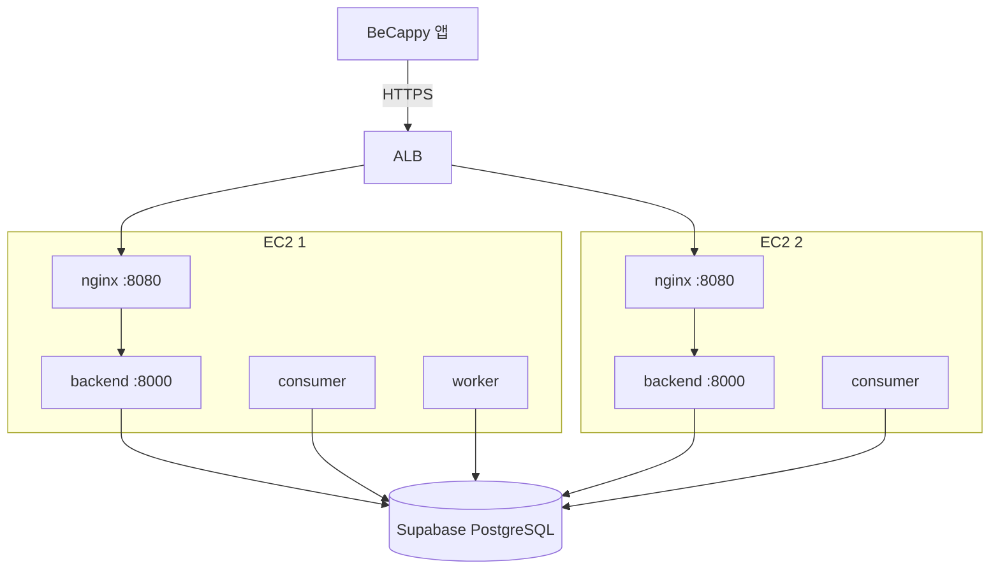
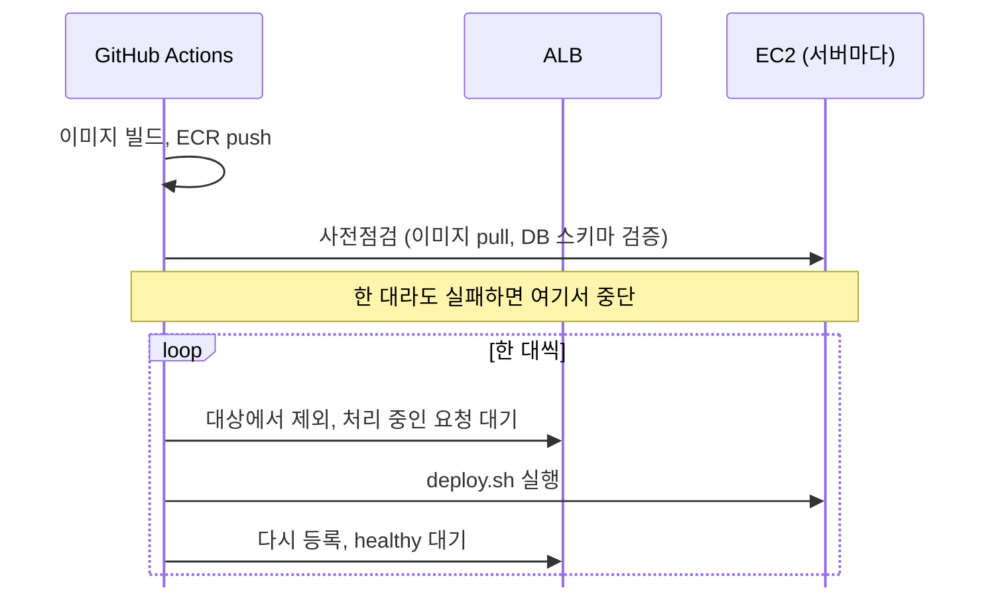

# moly-infra

BeCappy 백엔드를 AWS에서 운영하기 위한 배포 스크립트와 서버 설정입니다.

이미지 빌드와 배포 순서는 백엔드 레포의 GitHub Actions가 관리하고, 이 저장소는 각 서버 안에서 실행되는 부분을 맡습니다.

## 아키텍처

ALB가 HTTPS를 처리하고 두 서버로 요청을 나눕니다. 서버에는 SSH 대신 SSM Session Manager로 접속합니다.

컨테이너는 모두 같은 이미지에서 실행됩니다.

| 서비스 | 역할 |
|---|---|
| `backend` | FastAPI 앱. 포트를 127.0.0.1에만 열어서 외부 요청은 같은 EC2의 nginx를 거쳐서만 들어옵니다. |
| `consumer` | 대화 이후의 비동기 작업(기억, 요약, 일기 임베딩 등)을 처리합니다. 작업은 DB 테이블에 쌓이고, 두 서버가 `FOR UPDATE SKIP LOCKED`로 겹치지 않게 나눠 가져갑니다. |
| `worker` | systemd 타이머가 15분마다 실행하는 배치 작업(일기 생성, 푸시 알림)입니다. |

시크릿은 저장소에 두지 않고, 배포할 때 SSM Parameter Store에서 읽어 서버의 env 파일로 만듭니다.

## 배포 흐름

moly-backend의 main 브랜치에 머지되면 GitHub Actions가 아래 순서로 배포합니다. 각 서버에서는 SSM Run Command로 이 저장소를 pull 받은 뒤 `deploy.sh`를 실행합니다.

배포 중에 실패하면 그 서버는 ALB에서 빠진 채로 남고 workflow가 멈춥니다. 아직 배포하지 않은 서버는 이전 버전으로 계속 동작합니다. 롤백은 workflow를 수동으로 실행하면서 `image_tag`에 이전 커밋의 전체 SHA를 넣습니다.

### deploy.sh

ECR 로그인 → SSM 조회 → 이미지 pull → DB 스키마 검증 → 설정 파일 교체 → 컨테이너 실행 → 배포 확인 → 워커 타이머 갱신
